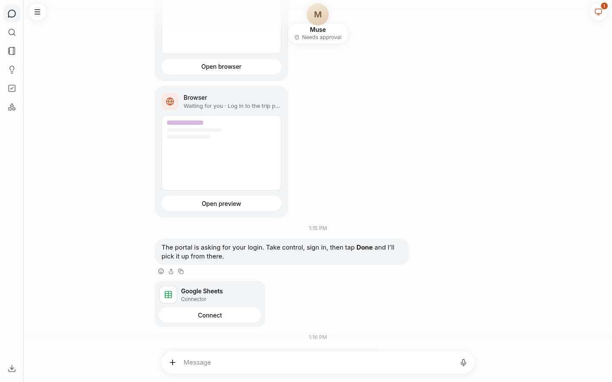

# remuse

A Muse-style personal assistant: chat with an agent that browses the web in a real Chrome you
can watch and take over (from a phone, too), and works with your apps. One instance per person,
run with Docker Compose.

<p>
  
  
</p>


## Start

```sh
git clone git@github.com:Microwave-WYB/remuse.git && cd remuse
docker compose up -d --build  # the first build takes a while: the browser images include Chromium
```

Open `http://localhost:8080` and set a password: the first visit sets it, and from then on it
opens remuse on each device. Run remuse where only you can reach it (your machine, your
tailnet) and set the password right away. An instance holds nothing of yours until you set it
up, so someone who got there first could only use it with their own keys; you would notice, as
the password would already be set (see "Forgot the password" below to start over).

Then, in Settings:

- **Models**: add an API key for a provider and choose the model Muse chats with and the one that
  works in the browser (it must see pictures). Any provider [Pi](https://github.com/earendil-works/pi)
  takes an API key for works: OpenRouter, Anthropic, OpenAI, Google Gemini, DeepSeek, Fireworks,
  xAI, Mistral, Groq, Moonshot (Kimi), Z.ai, and more. The model must support tool calls.
- **Connectors** (optional): a [Composio](https://composio.dev) API key lets Muse connect apps
  such as Gmail or Google Sheets.

Keys are kept in the `remuse-data` volume and never shown again, only their last characters.

## Other devices

remuse listens on `127.0.0.1:8080` only. To reach it from your phone over
[Tailscale](https://tailscale.com), either:

- listen on your Tailscale IP: in `.env`, `REMUSE_PUBLISH_HOST=100.x.y.z` and
  `REMUSE_PUBLIC_URL=http://100.x.y.z:8080` (plain http; Tailscale encrypts the link), or
- serve it over https: `tailscale serve --bg 8080`, and `REMUSE_PUBLIC_URL=https://my-pc.my-tailnet.ts.net`.
  Pasting from the phone's clipboard into the browser you take over needs https.

Then `docker compose up -d`.

## Good to know

- Your conversation, the password, your keys and saved browser logins live in Docker volumes;
  they survive restarts and updates. `docker compose down -v` deletes them.
- Update: `git pull && docker compose up -d --build`.
- Change the password, or lock a device: Settings › General. Changing it signs every other device out.
- Forgot the password: `docker compose exec remuse rm /data/access.json && docker compose restart remuse`,
  then set a new one on the next visit. Your chats and keys stay.
- Use another port: `REMUSE_PUBLISH_PORT=9000` in `.env` (and `REMUSE_PUBLIC_URL=http://localhost:9000`).

Development: [docs/development.md](docs/development.md).
