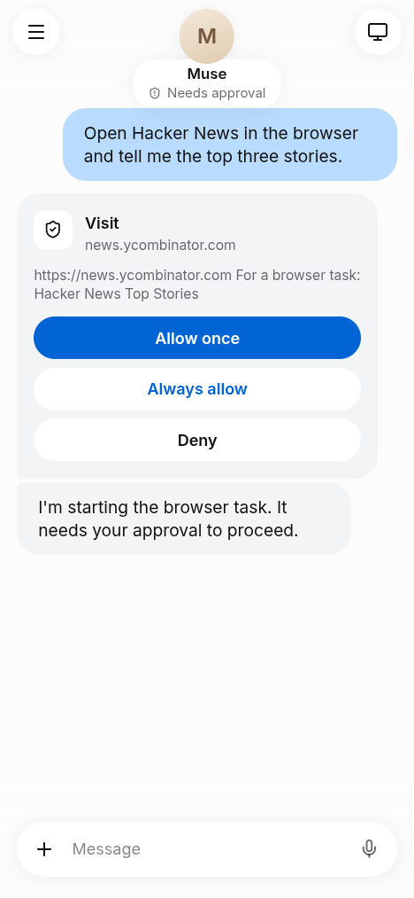
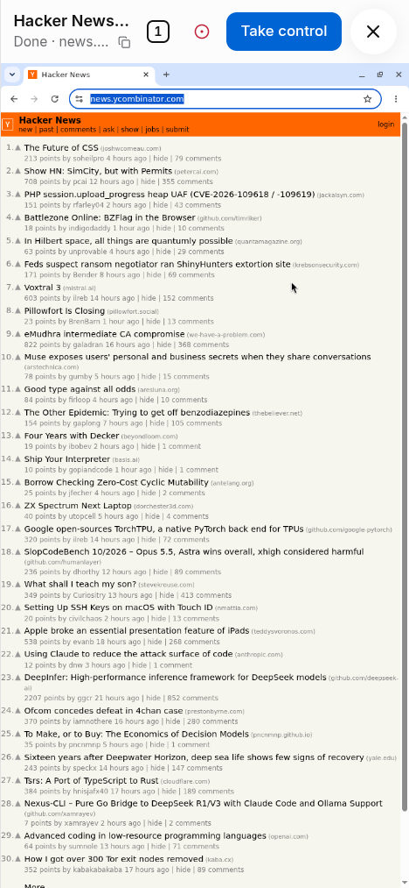
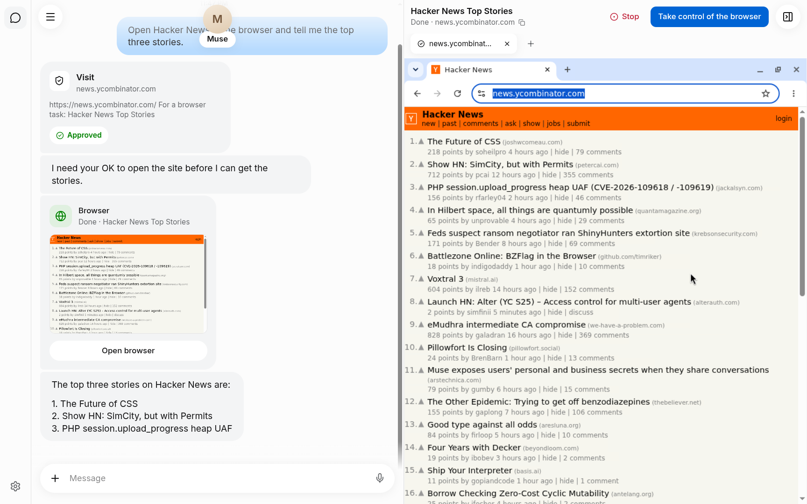

# Amuse

An open-source Muse: a personal assistant you chat with, that browses the web in a real Chrome
you can watch and take over (from a phone, too), and works with your apps. One instance per
person, run with Docker Compose.

<p>
  
  
</p>


## Start

```sh
git clone git@github.com:Microwave-WYB/amuse.git && cd amuse
docker compose up -d --build  # the first build takes a while: the browser images include Chromium
```

Open `http://localhost:8080`, set a password, and add an API key for a model provider in
Settings › Models (any provider [Pi](https://github.com/earendil-works/pi) supports). From there,
Amuse walks you through the rest, such as connecting your apps.

Run amuse where only you can reach it (your machine, your tailnet), and set the password right
away: the first visit sets it.

## Other devices

amuse listens on `127.0.0.1:8080` only. To reach it from your phone over
[Tailscale](https://tailscale.com), either:

- listen on your Tailscale IP: in `.env`, `AMUSE_PUBLISH_HOST=100.x.y.z` and
  `AMUSE_PUBLIC_URL=http://100.x.y.z:8080` (plain http; Tailscale encrypts the link), or
- serve it over https: `tailscale serve --bg 8080`, and `AMUSE_PUBLIC_URL=https://my-pc.my-tailnet.ts.net`.
  Pasting from the phone's clipboard into the browser you take over, and the mic, need https.

Then `docker compose up -d`.

## Voice

The mic turns what you say into text with OpenAI, Groq or Fireworks (your key), or a speech
server you run yourself (any OpenAI-style `/v1/audio/transcriptions`, e.g. faster-whisper-server):
Settings › Models › Voice. Run it in Docker beside Amuse and give its service name as the address;
on the host outside Docker it is `host.docker.internal`, which a host firewall (ufw) may block for
containers. The mic needs https (see above).

## Good to know

- Your conversation, the password, your keys and saved browser logins live in Docker volumes;
  they survive restarts and updates. `docker compose down -v` deletes them.
- Update: `git pull && docker compose up -d --build`.
- Change the password, or lock a device: Settings › General. Changing it signs every other device out.
- Forgot the password: `docker compose exec amuse rm /data/access.json && docker compose restart amuse`,
  then set a new one on the next visit. Your chats and keys stay.
- Use another port: `AMUSE_PUBLISH_PORT=9000` in `.env` (and `AMUSE_PUBLIC_URL=http://localhost:9000`).

Development: [docs/development.md](docs/development.md).

## License

[MIT](LICENSE). Amuse is an independent project, not affiliated with Meta or its Muse.
